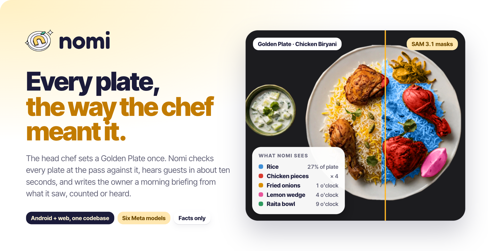
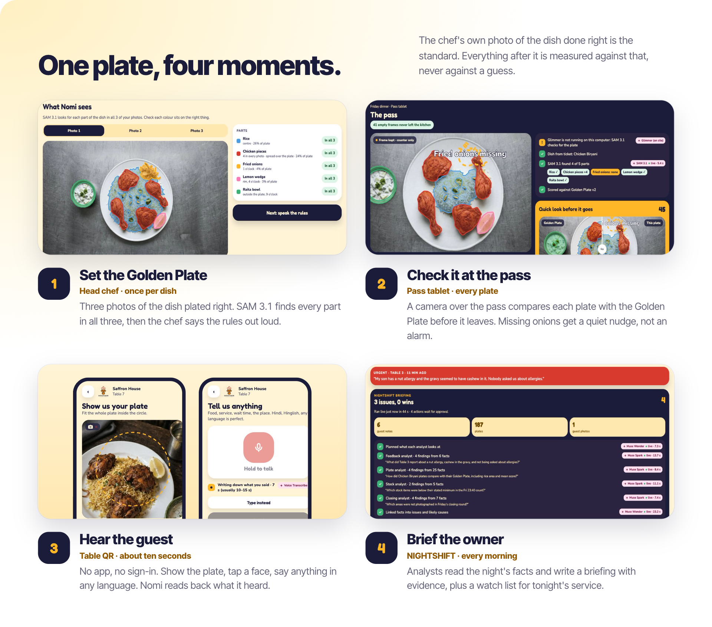
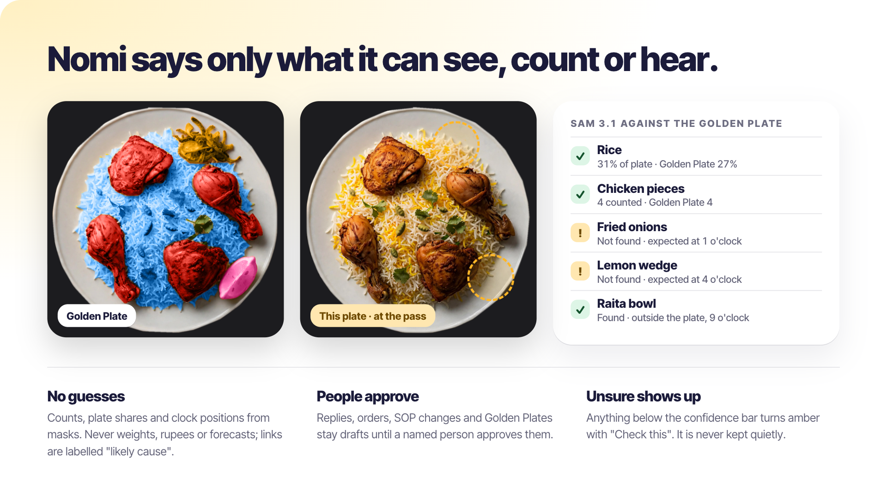
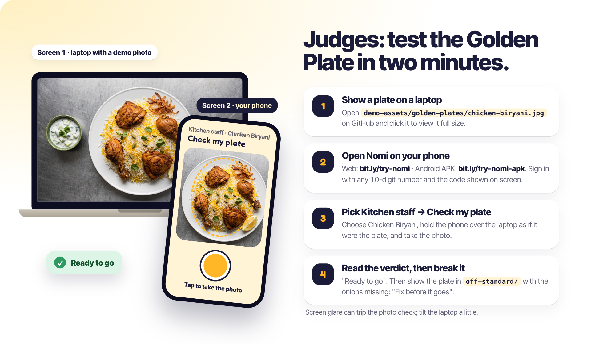
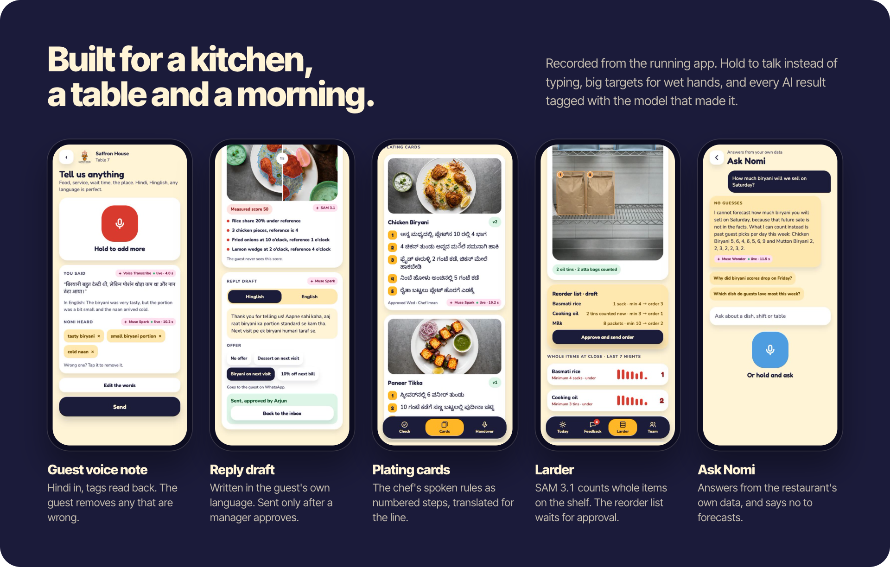
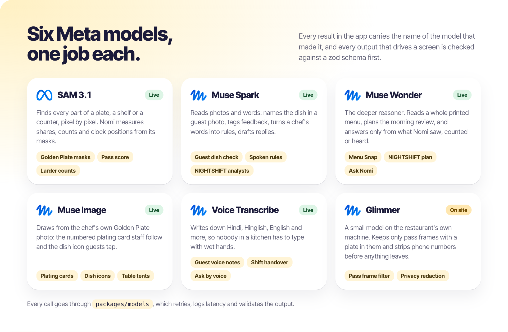
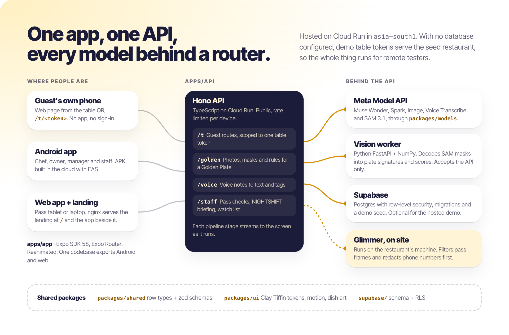

<p align="center">
  
</p>

<p align="center">
  <a href="https://bit.ly/try-nomi"></a>
  <a href="https://bit.ly/try-nomi-apk"></a>
  
  
</p>

Nomi keeps every plate in a restaurant the way the head chef meant it. The chef sets a **Golden Plate** once: three photos,
SAM 3.1 masks, and the rules said out loud. The pass camera checks each plate against it before it leaves, guests give
feedback from a table QR in about ten seconds in any language, and each morning **NIGHTSHIFT** turns the night's facts into
a briefing and a watch list for tonight.

One Expo codebase builds the Android app and the web app, the guest QR page included. Built for the **Meta Global AI
Developer Hackathon** (Oct 26 – Nov 4, 2026); all code in this repository was written during the event.

## What it does

<p align="center">
  
</p>

<p align="center">
  
</p>

## Try it: judges' guide

<p align="center">
  
</p>

You need a laptop (or any second screen) and a phone. Nothing to install for the web version.

1. **On the laptop**, open [`demo-assets/golden-plates/chicken-biryani.jpg`](demo-assets/golden-plates/chicken-biryani.jpg) and view it full size.
2. **On the phone**, open **[bit.ly/try-nomi](https://bit.ly/try-nomi)**, or install the Android app from
   **[bit.ly/try-nomi-apk](https://bit.ly/try-nomi-apk)**. Sign in with any 10-digit number and the code shown on screen.
3. Pick **Kitchen staff → Check my plate → Chicken Biryani**. Hold the phone over the laptop as if it were the plate and take
   the photo. SAM 3.1 finds every part: **"Ready to go"**.
4. Now show [`off-standard/chicken-biryani--onions-missing.jpg`](demo-assets/off-standard/chicken-biryani--onions-missing.jpg)
   and check again: **"Fix before it goes"**, fried onions missing.

Glare from the screen can lower the photo check; tilt the laptop a little if it complains. Leave **Demo camera** off (the
default) so the phone's own camera is used.

<details>
<summary><b>More to try with the demo photos</b></summary>

<br>

Every photo in [demo-assets/](demo-assets/README.md) was made by Muse Image. Clone the repo and open
`demo-assets/index.html` for a full-screen viewer: arrow keys step through 20 photos, and each one says which screen to open
and what Nomi should find.

| Show this on the laptop | Open this on the phone | What happens |
| --- | --- | --- |
| [`kitchen/calibration-empty-plate.jpg`](demo-assets/kitchen/calibration-empty-plate.jpg), then [`golden-plates/mutton-biryani.jpg`](demo-assets/golden-plates/mutton-biryani.jpg) for each of the three photos | Head Chef → Dishes → **+ Add a Golden Plate** | Calibrate, three photos through the quality gate, then SAM 3.1 masks for every part |
| [`golden-plates/`](demo-assets/golden-plates) | Kitchen staff → Check my plate | SAM 3.1 finds every part: "Ready to go" |
| [`off-standard/`](demo-assets/off-standard) | Kitchen staff → Check my plate | Nomi names what is wrong: a piece short, a part missing |
| [`guest-photos/`](demo-assets/guest-photos) | Guest page (Under the hood → Guest page) → Show us your plate | Muse Spark names the dish |
| [`menu/1-printed-menu.jpg`](demo-assets/menu/1-printed-menu.jpg) | Head Chef → Dishes → Snap a new menu | Muse Wonder types up the menu; unreadable fields come back amber |
| [`kitchen/dry-store.jpg`](demo-assets/kitchen/dry-store.jpg) | Manager → Larder → Scan a shelf | SAM 3.1 counts whole items |

No second screen? Tap your avatar (top right) and turn **Demo camera** on: every camera plays these same photos and the model
calls stay live. Every screen with a mic has **No mic? Play a sample voice note**, which sends a recorded Hindi or English
clip through Voice Transcribe. **Under the hood** in the role picker lists the six Meta models and every live call the phone
made.

</details>

## Screens

<p align="center">
  
</p>

## Under the hood

<p align="center">
  
</p>

<p align="center">
  
</p>

```text
apps/
  app/             Expo (SDK 58) app: staff tabs + guest route /t/[token]; exports Android and web
  site/            Landing page (Vite + GSAP): the whole story as pinned scroll scenes, every dish drawn in SVG
  api/             Hono API: guest routes (token-scoped, rate-limited), Golden Plate, voice and staff routes
packages/
  shared/          Row types and zod schemas for every model output
  models/          Meta Model API router (Wonder, Spark, Image, Voice, SAM) + local Glimmer client
  ui/              Clay Tiffin tokens, motion presets, components, dish and face art
services/
  vision-worker/   Python FastAPI: plate signatures from SAM masks, plate scoring
supabase/          Migrations (schema + RLS) and demo seed
design/            Logo stickers (fun-isometric) and the Clay Tiffin stylesheet
demo-assets/       Photos to show on a second screen (see the judges' guide above)
docs/              Experience map, demo image prompts, and the README images (docs/readme)
video/             The pitch film (Remotion) and the app recordings it uses
```

## Run it locally

```bash
cp .env.example .env          # add MODEL_API_KEY
npm install
npm run app:web               # http://localhost:8081, guest page at /t/demo-table-7
```

The guest page and every staff screen render from seed data without the API. Sign in with any 10-digit number and the code
shown on screen, then pick a role (Head Chef, Owner, Manager, Kitchen staff); tap the avatar at the top right to switch
roles. [docs/experience-map.md](docs/experience-map.md) lists every journey, AI feature and UI rule.

To run the full stack:

```bash
supabase start                # needs Docker; copy the service_role and anon keys into .env
supabase db reset             # applies migrations and seed
npm run api                   # http://localhost:8787
npm run smoke -w @nomi/models # one cheap call to prove the model key works
```

Android: `npm run app:android` with a device or emulator connected.

Landing page: `npm run site` (http://localhost:5174/site/; its links open the Expo dev server on port 8081).

<details>
<summary><b>Vision worker</b></summary>

<br>

Decodes and measures SAM 3.1 masks for the Golden Plate masks step and the pass score; the API calls it on port 8001.

```bash
cd services/vision-worker && python3 -m venv .venv && .venv/bin/pip install -r requirements.txt
.venv/bin/uvicorn app:app --port 8001   # run it
.venv/bin/python -m pytest              # test it
```

Without the API or the worker, the masks step says so and offers a recorded sample plate instead.

</details>

<details>
<summary><b>Deploy: hosted web, backend and the Android APK</b></summary>

<br>

**Hosted web front end:** `deploy/gcp.sh web` builds the landing and the Expo web export (pointed at the hosted API) and
serves both from one nginx service, `nomi-web`: the landing at `/`, the app on its own routes (`/sign-in`, `/setup`,
`/t/demo-table-7`). Table QR codes on the web point at the host they are shown on, so a phone can scan one from a laptop.

**Hosted backend for remote testers:** `deploy/gcp.sh` builds the API and vision worker with Cloud Build and runs them on
Cloud Run (project `genai-hack-project-nexus`, region `asia-south1`; override with `GCP_PROJECT` and `GCP_REGION`). The model
key goes from `.env` into Secret Manager. The API is public and rate limited per device; the worker only accepts the API.
With no database configured, demo table tokens serve the seed restaurant and feedback is not saved. Both keep one warm
instance, so scale them to zero after judging.

**Android APK** to install on any phone (built in the cloud with EAS, no Android Studio needed):

```bash
cd apps/app && npx eas-cli@latest login     # once, with a free Expo account
npx eas-cli@latest env:set --environment preview --name EXPO_PUBLIC_API_URL --value <hosted API URL> --visibility plaintext
npm run app:apk                             # from the repo root; first run links the project and creates the signing key
```

Open the link or QR code it prints on the phone to install. The API address is baked in at build time; it is set to the
hosted API, so the APK works anywhere. Change it with `env:set` and build again. `.easignore` keeps `design/`, `docs/`,
`services/` and `supabase/` out of the upload.

</details>

<details>
<summary><b>Demo media</b></summary>

<br>

Demo photos for a mock run (Golden Plates, good and off-standard plates, guest photos, shelves, the closing round, the menu)
are listed with their prompts in [docs/demo-images.md](docs/demo-images.md). `npm run demo:media -w @nomi/models` makes the
missing ones with Muse Image and saves a real SAM 3.1 run next to each.

The README images are HTML pages in [docs/readme/src](docs/readme/src) built from the app's own recordings and plate
cutouts. `node docs/readme/render.mjs` renders them to PNG (it uses Playwright from `video/` and your installed Chrome).

</details>

## Rules

- Every model call goes through `packages/models`; every output that drives UI is validated with zod.
- Nomi shows only what it can see, count or hear, with evidence. No guessed volumes, weights, money or predictions.
- Every AI-proposed action waits for a human approval.

## Open-source libraries

Expo, React Native, Expo Router, Reanimated, react-native-svg, Hono, Supabase, zod, the OpenAI-compatible SDK, FastAPI,
NumPy. Landing: Vite and GSAP. Pitch film: Remotion. Fonts: Fredoka, Nunito and Inter Tight (Google Fonts). Logo animation
made with fun-isometric by Kelvin Adithya.

<br>

<p align="center">
  <br>
  <b>nomi</b> · Every plate, the way the chef meant it.<br>
  <a href="https://bit.ly/try-nomi">bit.ly/try-nomi</a>
</p>
